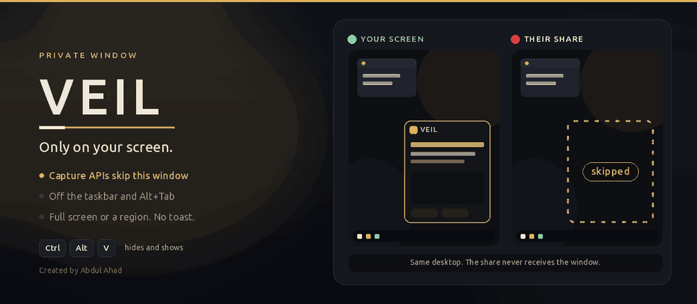

<p align="center">
  
</p>

<p align="center">
  
  
  
  
</p>

<p align="center">
  A private window for Windows.<br>
  Screen share skips it. The taskbar never lists it. Shots stay silent.
</p>

---

Veil is a browser you can leave open while you share your screen. The window is marked so capture APIs that honor Windows display affinity leave it out. It has no taskbar button, it stays out of Alt+Tab, and a global hotkey hides it or brings it back.

The page inside can be anything. Notes live on the start page. This PC opens in the same frame. A shot of the real desktop can land straight in a ChatGPT or Gemini box.

## What it does

<table>
<tr>
<td width="33%" valign="top">

**Off the capture**

The window sets `WDA_EXCLUDEFROMCAPTURE`. Shares and screenshot tools that honor that flag record the desktop underneath, not this window.

</td>
<td width="33%" valign="top">

**Off the taskbar**

No taskbar button and no Alt+Tab entry. A second launch finds the window that is already open and brings it forward.

</td>
<td width="33%" valign="top">

**One hotkey**

<kbd>Ctrl</kbd> + <kbd>Alt</kbd> + <kbd>V</kbd> hides it and shows it. If that combo is taken, Veil tries <kbd>Ctrl</kbd> + <kbd>Shift</kbd> + <kbd>V</kbd>, then <kbd>Ctrl</kbd> + <kbd>Alt</kbd> + <kbd>Space</kbd>.

</td>
</tr>
<tr>
<td width="33%" valign="top">

**Silent shot**

Full screen, or a region you drag. No shutter, no toast, no Snipping Tool. The PNG goes to `Pictures\Screenshots`.

</td>
<td width="33%" valign="top">

**Paste into the chat**

If ChatGPT or Gemini is the open page, the shot is pasted into the message box. Otherwise it opens inside Veil.

</td>
<td width="33%" valign="top">

**This PC, in the window**

The address bar takes a site, a search, or a folder path. **PC** hosts This PC in the same private window.

</td>
</tr>
</table>

## The bar

| | |
| --- | --- |
| **Back** | The previous page, or the folder you came from. |
| **Address** | A site, a search, or a path such as `C:\Users`. |
| **Home** | The start page. Notes typed there are kept on this computer. |
| **PC** | Browse This PC without leaving the window. |
| **Shot** | Full screen, or a region. Esc cancels the region. |
| **Pin** | Stay above other windows, or stop doing that. It starts pinned. |
| **Light / Dark** | Switch the chrome. The choice is remembered. |
| **Hide** | Put the window away. The hotkey brings it back. |

The title bar moves the window directly. There is no drag ghost and no edge-snap.

## Run

Windows 10 or 11, with the [WebView2 runtime](https://developer.microsoft.com/microsoft-edge/webview2/) installed. Python needs `pywebview` and `pythonnet`.

```bat
pip install pywebview pythonnet
pythonw Veil.pyw
```

`pythonw` keeps the console off the desktop. `Veil.lnk` does the same thing. The home page names the hotkey that actually registered.

## While you share

A few things are there so the share stays clean.

The pointer over text, links, and buttons stays the normal arrow. Windows draws the cursor on top of a capture, so an I-beam would still show up on the share.

The region picker does not take the mouse, and it is excluded from capture too. The cursor on the share stays whatever it already was. Drag a rectangle. Esc cancels.

Opening Veil from a full-screen app holds the taskbar down. Explorer would otherwise pop the bar up, and that pop would land in the capture.

Close, minimize, and maximize keep their color when focus moves between Veil and the shared window, so the caption buttons do not flash.

<details>
<summary>What “skipped” does and does not mean</summary>

<br>

Veil asks Windows to leave this window out of capture. Teams, Zoom, Discord, OBS, and the screenshot tools that use the modern graphics capture path follow that. The people on the share see the desktop. They do not see the window.

A photograph of the monitor still shows it. A capture path that ignores display affinity can still see it. Someone sitting at the machine can see it. Veil is a private window for a screen share, not a lock on the computer.

</details>

## On this computer

Nothing is uploaded. Notes, theme, and the window’s place are files under your profile.

| | |
| --- | --- |
| Notes | `%APPDATA%\Veil\notes.txt` |
| Theme | `%APPDATA%\Veil\theme.txt` |
| Window position | `%APPDATA%\Veil\window.txt` |
| Log | `%APPDATA%\Veil\veil.log` |
| Browser profile | `%APPDATA%\Veil\webview\` |
| Screenshots | `%USERPROFILE%\Pictures\Screenshots` |

## Project

```
Veil.pyw        window, browser, hotkey, theme, paste
veil_shot.py    silent capture and the region picker
veil_files.py   This PC, hosted in the window
veil.ico        icon
```

<p align="center">
  Created by Abdul Ahad
</p>
